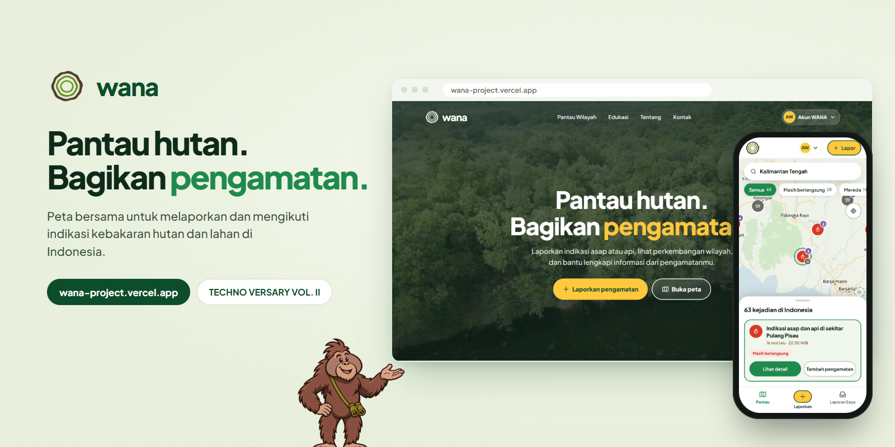
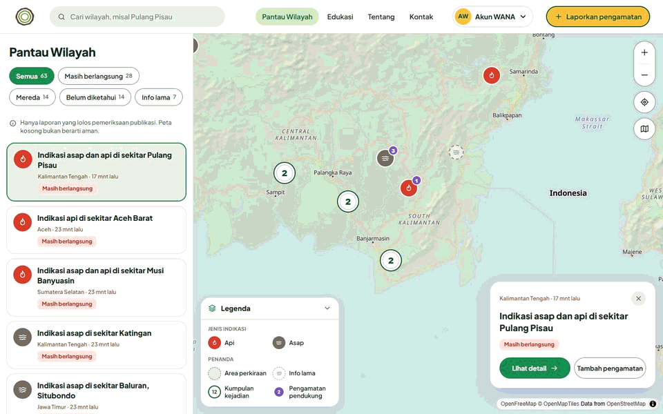
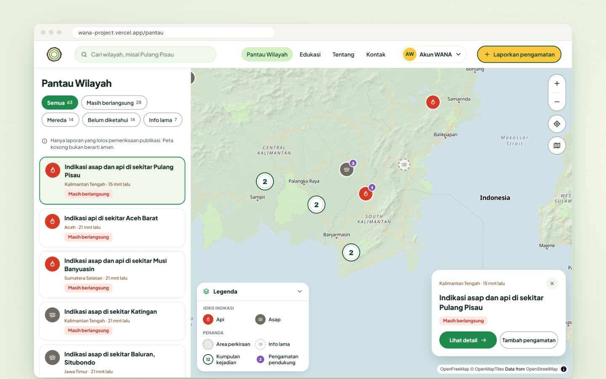
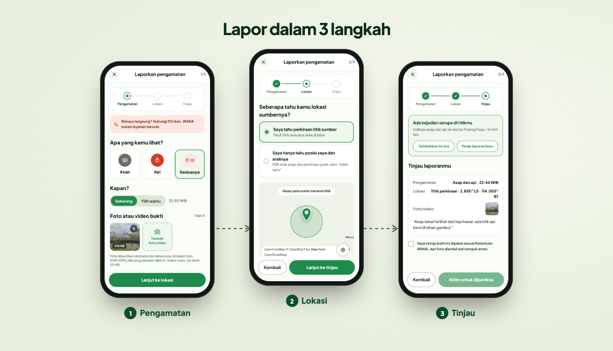
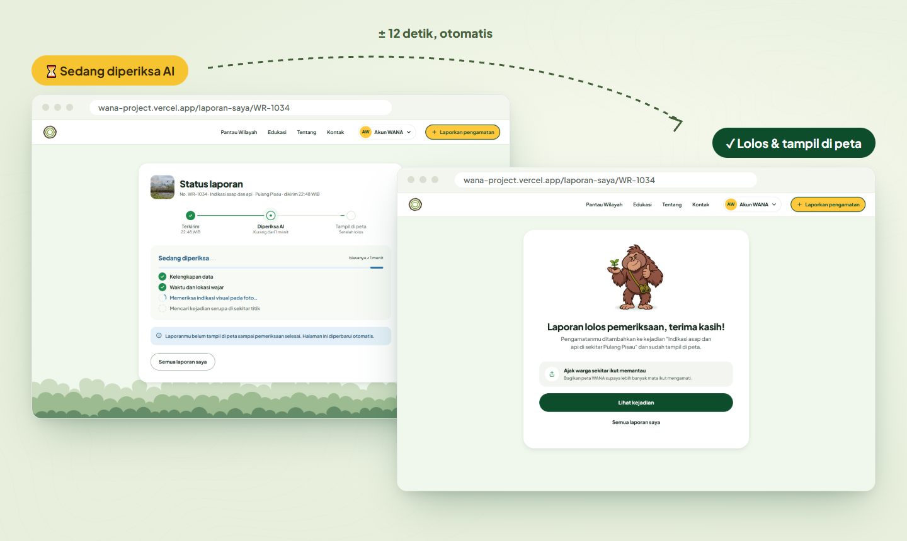
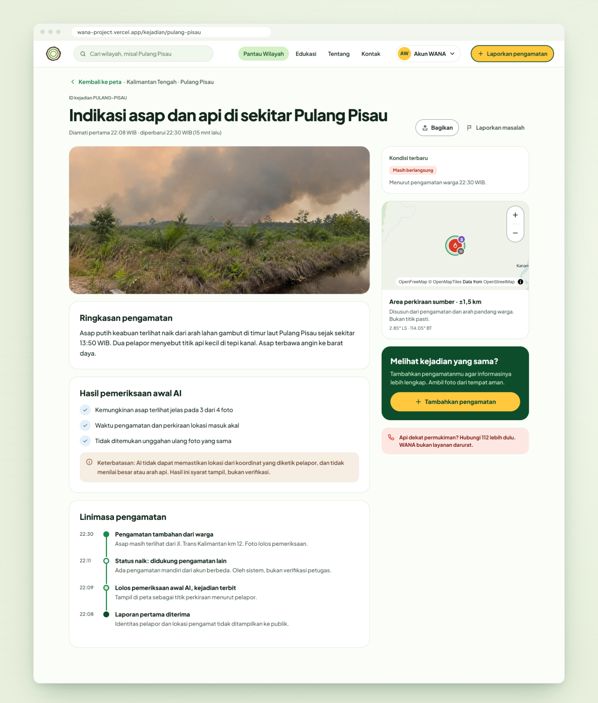
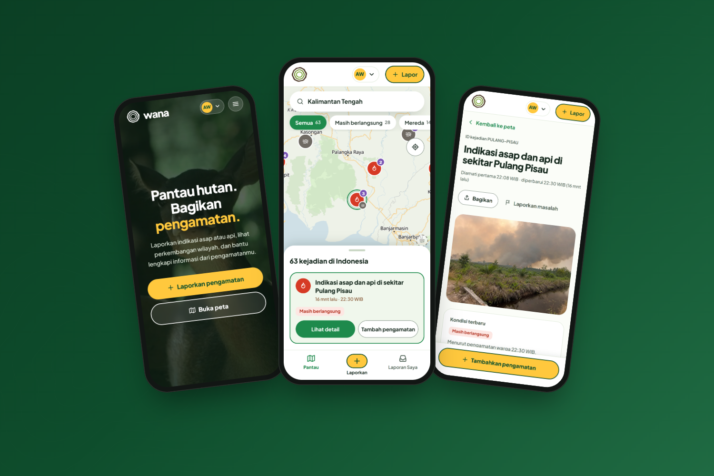
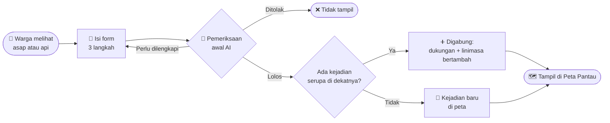
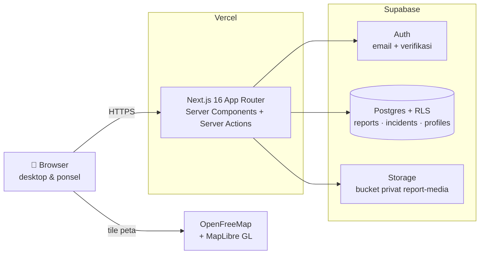

<div align="center">



# WANA

### Pantau hutan. Bagikan pengamatan.

Peta bersama untuk melaporkan dan mengikuti indikasi kebakaran hutan dan lahan (karhutla) di Indonesia.

[](https://wana-project.vercel.app/)


[Coba demo](https://wana-project.vercel.app/) · [Lihat peta](https://wana-project.vercel.app/pantau) · [Laporkan pengamatan](https://wana-project.vercel.app/lapor) · [Panduan setup](docs/SETUP.md)

</div>

> [!TIP]
> **Juri dan penguji tidak perlu mendaftar.** Buka [halaman masuk](https://wana-project.vercel.app/masuk), lalu klik **Masuk dengan akun demo**.

> [!NOTE]
> WANA adalah prototipe lomba. **Seluruh kejadian di peta adalah data simulasi**, dan pemeriksaan AI juga disimulasikan.

---

## 🔥 Masalah

Setiap musim kemarau, kebakaran hutan dan lahan gambut kembali muncul di Sumatra, Kalimantan, dan wilayah lain di Indonesia. Warga sekitar sering menjadi yang pertama melihat asap atau api, tetapi informasinya:

- **tercecer** di grup chat dan media sosial, tanpa lokasi yang jelas;
- **sulit dipercaya**, karena foto lama atau foto dari tempat lain mudah tersebar ulang;
- **cepat basi**, karena tidak ada yang tahu apakah api masih menyala atau sudah padam.

## 🌱 Solusi

**WANA** mengumpulkan pengamatan warga ke **satu peta bersama**. Setiap laporan diperiksa sebelum tampil, laporan untuk lokasi yang sama digabung menjadi satu kejadian, dan setiap kejadian menunjukkan **seberapa kuat buktinya** serta **seberapa baru informasinya**.

<div align="center">

| 👀 **Amati** | 🤖 **Diperiksa** | 🗺️ **Dilengkapi** |
|:---:|:---:|:---:|
| Lihat asap atau api? Potret dari tempat aman, lalu tandai lokasi atau arahnya. | AI memeriksa foto, waktu, dan lokasi. Lolos berarti layak tampil, belum berarti terverifikasi. | Laporan tampil di peta, dan warga lain bisa menambah pengamatan di kejadian yang sama. |

</div>

## 🎬 Demo

<div align="center">

<sub>Dari peta, isi form 3 langkah, kirim, lalu laporan diperiksa dan lolos dalam ±12 detik.</sub>
</div>

## ✨ Fitur utama

### 🗺️ Peta Pantau Wilayah

Peta nasional dengan penanda yang dikelompokkan (cluster), filter kondisi (*masih berlangsung*, *mereda*, *belum diketahui*, *info lama*), daftar kejadian, dan popover ringkas. Kejadian yang tidak diperbarui lebih dari 48 jam otomatis ditandai **info lama**, supaya peta tidak menyesatkan.



### 📸 Lapor dalam 3 langkah

Form pendek yang aman dan menjaga privasi pelapor:

- **Pengamatan**: pilih *asap*, *api*, atau *keduanya*, waktu kejadian, dan hingga 4 foto/video.
- **Lokasi**: taruh titik perkiraan sumber, atau cukup posisi pengamat + arah asap kalau tidak tahu titik pastinya.
- **Tinjau**: kalau ada kejadian serupa di dekat titik itu, WANA menawarkan untuk **menggabungkan** laporan, sehingga tidak muncul duplikat.

Foto dikecilkan otomatis (maks. 1920 px), dan **data lokasi di dalam foto (EXIF/GPS) dibuang** sebelum diunggah.



### ⏱️ Status laporan secara langsung

Setelah dikirim, pelapor bisa mengikuti setiap tahap pemeriksaan: kelengkapan data, kewajaran waktu dan lokasi, indikasi visual pada foto, dan pencarian kejadian serupa. Halaman diperbarui otomatis sampai laporan **lolos dan tampil di peta**, atau diminta untuk **dilengkapi**.



### 📋 Detail kejadian yang transparan

Setiap kejadian punya galeri foto, ringkasan pengamatan, **hasil pemeriksaan awal AI beserta keterbatasannya**, area perkiraan sumber, dan **linimasa** dari laporan pertama sampai pengamatan terbaru. Identitas pelapor dan lokasi pengamat tidak pernah ditampilkan ke publik.

<details>
<summary><b>Lihat tangkapan layar halaman detail</b></summary>
<br>

</details>

### 🧭 Lapisan bukti yang jujur

WANA membedakan dengan tegas antara *layak tampil* dan *terverifikasi*:

| Tingkat | Artinya |
|---|---|
| 🔵 **Lolos AI** | Foto, waktu, dan lokasi masuk akal. Ini syarat tampil di peta, **bukan** verifikasi. |
| 🟢 **Didukung warga** | Ada pengamatan mandiri dari akun lain untuk kejadian yang sama. |
| ⚪ **Terverifikasi petugas** | Dikonfirmasi pihak berwenang (rencana pengembangan). |

### 📱 Mobile-first

Dirancang untuk dipakai di lapangan lewat ponsel: bottom sheet di peta, tab bar bawah, tombol besar, dan pengingat keselamatan (*"Ambil foto dari tempat aman"*, *"Hubungi 112"*) di titik-titik yang tepat.



## 🔄 Alur laporan



## 🏗️ Arsitektur



## 🧰 Teknologi

| Lapisan | Teknologi |
|---|---|
| Framework | **Next.js 16** (App Router, Server Actions), **React 19**, TypeScript |
| Tampilan | **Tailwind CSS 4**, Motion (animasi), Plus Jakarta Sans |
| Peta | **MapLibre GL** + **Supercluster**, tile dari OpenFreeMap / OpenStreetMap |
| Backend | **Supabase**: Auth, Postgres dengan Row Level Security, Storage |
| Hosting | **Vercel** |

## 🚀 Menjalankan secara lokal

```bash
git clone https://github.com/hanchyp/wana.git
cd wana
npm install
cp .env.example .env.local   # isi URL & publishable key Supabase
npm run dev
```

Buka http://localhost:3000. Setup Supabase lengkap (auth, template email, migrasi, akun demo) ada di **[docs/SETUP.md](docs/SETUP.md)**.

## 📁 Struktur proyek

```
app/                 # Rute Next.js: beranda, pantau, kejadian, lapor, laporan-saya, auth
components/          # Peta, navigasi, kartu status, maskot, form akun
lib/                 # Tipe & label kejadian, akses Supabase, kompresi media
supabase/migrations/ # Skema, RLS, simulasi pemeriksaan AI, seed 63 kejadian
public/              # Logo, maskot, foto, video hero, peta SVG
docs/                # Panduan setup & gambar README
```

## 🛣️ Rencana pengembangan

- [ ] Pemeriksaan gambar dengan model AI sungguhan (deteksi asap/api, deteksi foto daur ulang)
- [ ] Integrasi titik panas satelit (mis. NASA FIRMS) sebagai lapisan pembanding
- [ ] Verifikasi oleh petugas (BPBD / Manggala Agni) untuk tingkat **Terverifikasi**
- [ ] Notifikasi kejadian baru di sekitar wilayah pengguna
- [ ] Mode offline untuk area dengan sinyal lemah

## 👥 Tim

| Nama | Peran | GitHub |
|---|---|---|
| Farhan Cahya Permana | Fullstack Developer | [@hanchyp](https://github.com/hanchyp) |
| Alissa Tukhriyatun Nufus | Fullstack Developer | [@aluryy](https://github.com/aluryy) |

---

<div align="center">

**WANA bukan layanan darurat.** Untuk bahaya langsung, hubungi **112** atau pemadam kebakaran **113**.

Dibuat untuk **TECHNO VERSARY VOL. II** 🌳

</div>
